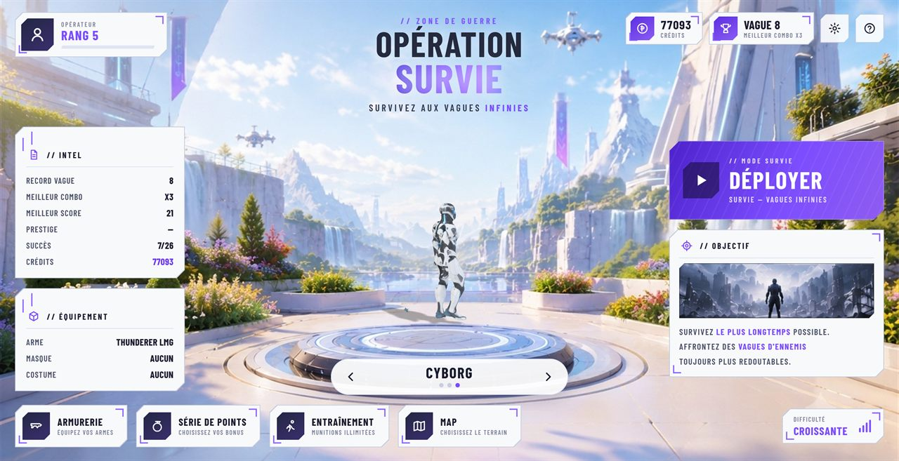
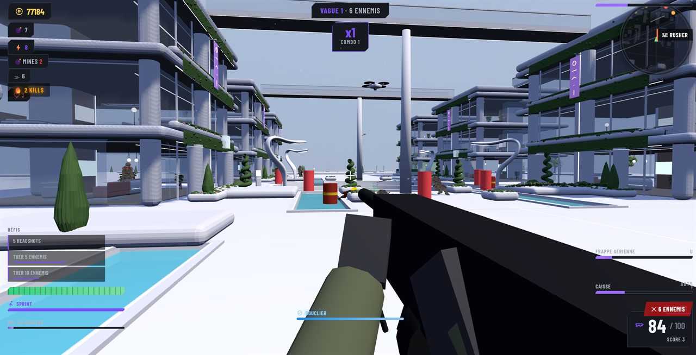
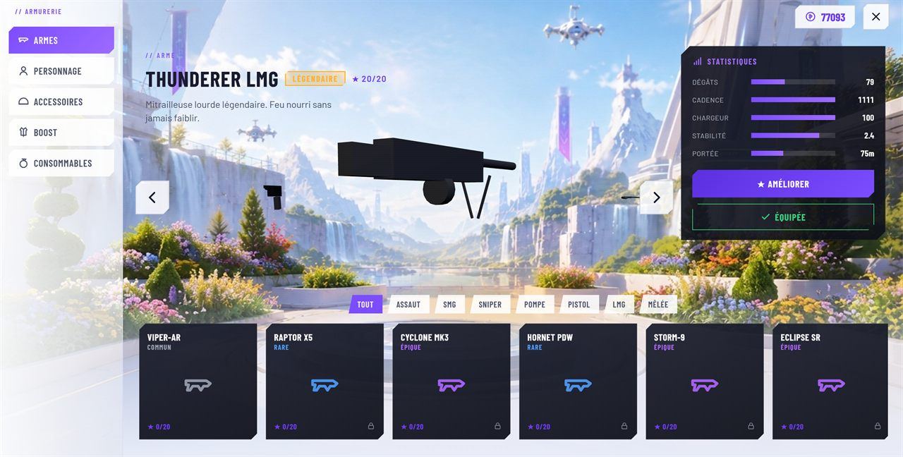
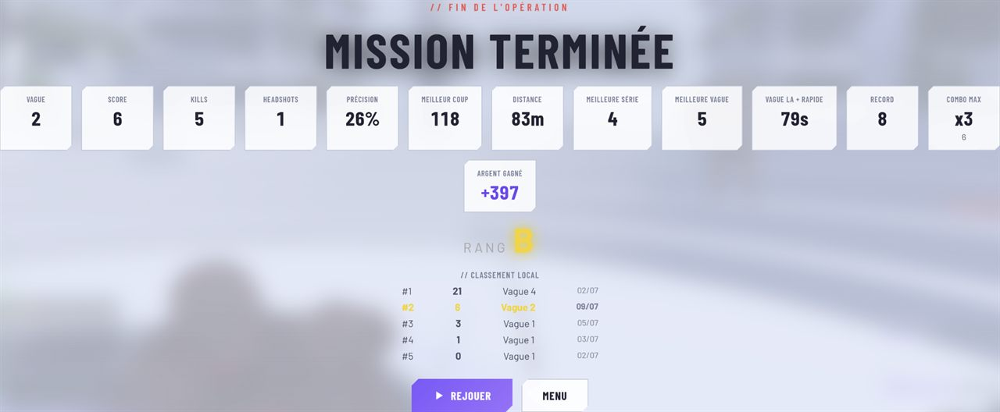

<div align="center">


# Opération Survie

**A wave-survival first-person shooter that runs entirely in the browser.**

A Call of Duty-style FPS built with Three.js and no build step. Survive escalating waves of enemy types and bosses, earn money, and spend it in a 3D shop on weapons, characters, accessories and upgrades. The repo also ships two tools to import and preview characters and animations.

[Features](#features) · [**Installation**](#installation) · [Under the hood](#under-the-hood) · [Tech stack](#tech-stack) · [Built with AI](#built-with-ai-assistance) · [Project structure](#project-structure)


[](LICENSE)

</div>

<p align="center">
  
  
  
  
</p>

> The interface is in French. This is the original web version of the game; a mobile port built with Unity lives in [Nathan-Part/FPS](https://github.com/Nathan-Part/FPS).

## Features

### Gameplay

- **Wave survival** with a best-wave record, a boss every 5 waves and an in-run HUD (health, shield, ammo, combo, dash, power-ups, radar).
- **First and third person** views, running, jumping, aiming down sights with light aim assist, reloading, dash, knife melee and throwable grenades with an aiming arc.
- **Enemy AI** with many enemy types (rusher, shooter, tank, bomber, sniper, medic, shielder, grenadier, ghost and more, one model folder each under `perso/`), line-of-sight checks, flanking and cover.
- **Combat feedback**: localized damage (head, torso, legs), floating damage numbers, kill callouts, killstreak combo multiplier, corpses with droppable weapon loot, explosive barrels.
- **Consumables and pickups**: several grenade types, deployables (mine, turret), health and ammo packs, care packages, and around fifteen timed power-ups.
- **A war dog companion** that can be summoned from the loadout.
- **Three maps**: *Portail des ruines*, *Arène urbaine* and *Cité utopique*, with variable-height ground (amphitheatre steps, bridges, hills, accessible rooftops).
- **Difficulty modes**, daily contracts, achievements, ranks and persistent stats.

### Lobby and shop

- 3D showcase lobby with the selected character and money/record display.
- Shop tabs for **weapons** (catalogue by category, upgrades), **characters**, **accessories** (masks, suits), **boosts** (vests, boots, medals) and **dances**, all with a rarity system (Common to Legendary).
- Settings for mouse sensitivity, volume, default view and optional toggles, saved in the browser.

### Studio tools

- `studio.html`: import, tune and preview characters and animations, and flag which characters are playable in the game.
- `app.html`: the original animation retargeting tool.

## Installation

Requires a modern browser, internet access (Three.js is loaded from a CDN) and a local HTTP server **that lists directory contents**, because the game discovers characters and animations by reading the `perso/` and `animation/` folder listings. Python's built-in server and Apache (WAMP, XAMPP...) both do this.

```bash
git clone https://github.com/Nathan-Part/games.git
cd games
python -m http.server 8000
```

Then open http://localhost:8000/game.html. The studio tools are at `studio.html` and `app.html`.

> Opening `game.html` directly from the file system (`file://`) does not work: browsers block ES modules and asset loading without a server.

### Run the tests

```bash
npm install
npx playwright install chromium
npm test
```

The Playwright config starts its own server on port 8123 and runs the tests sequentially, because software 3D rendering saturates the CPU. The full suite is slow (about an hour); target a file or a pattern with `npx playwright test tests/shop.spec.js` or `-g "pattern"`.

### Controls

| Key | Action |
| --- | --- |
| `Z` `Q` `S` `D` / arrows | Move |
| `R` or `Shift` | Run |
| `Space` | Jump |
| `E` or left click | Fire |
| `A` or right click | Aim |
| `F` | Reload |
| `B` | Grenade (hold to show the arc, release to throw) |
| `C` | Dash |
| `X` | Knife |
| `G` | Pick up a dropped weapon |
| `1` `2` `3` | Dances |
| `4` | Summon the war dog |
| `V` | Switch first/third person |
| `M` | Mute |
| `Esc` | Pause |

Keys are bound with `event.code`, so the layout is AZERTY.

## Under the hood

- **No build step**: native ES modules with an import map that loads Three.js `0.160.0` from a CDN. Serving the folder over HTTP is enough.
- **Data-driven design**: enemy types, weapon and shop catalogues, timed power-ups and maps live in tables, and a small feature registry (`registry.js`) calls per-feature `update`, `resetRun` and `onLobby` hooks from the game loop.
- **Single run reset**: all per-run state is cleared in one `resetRunState()` used by both start and restart, which removed a recurring class of asymmetry bugs.
- **Animations retargeted at runtime**: clips are retargeted onto each character's skeleton in world space, with in-place locomotion driven by code. Character and weapon sizes are normalized from the skeleton height rather than the bounding box.
- **Ground height engine**: `groundHeight(x, z)` combines analytic zones (disk, ring, rectangle, ramp, arch, grid) per map, and the player and enemies follow it with step-up limits.
- **Persistence**: progress is saved in `localStorage`, and the shared character gallery lives in IndexedDB.
- **Test hook**: the game exposes `window.__game` with a debug API that the end-to-end tests drive.
- **Ready for a port**: `unity-spec/` holds all the gameplay data (weapons, enemies, waves, economy...) as JSON. It is the source of truth used by the [Unity version](https://github.com/Nathan-Part/FPS), and `docs/migration-unity.md` describes the porting plan.

## Tech stack

| Area | Choice |
| --- | --- |
| Rendering | Three.js r160 (GLTF and Draco-compressed models) |
| Language | Vanilla JavaScript (ES modules), HTML, CSS |
| Audio | Web Audio API synthesis |
| Storage | `localStorage` and IndexedDB |
| Tests | Playwright (Chromium headless with software rendering) |
| 3D assets | Characters, weapons and animations in GLB; scenery credited in `decor/CREDITS.md` |

## Built with AI assistance

This game was developed with the help of [Claude Code](https://claude.com/claude-code), which wrote and refactored much of the code, the end-to-end tests and the map tooling (including exporting the Utopia map from Blender through the Blender MCP bridge). Game design, art direction, the Blender scenes and playtesting are by Nathan-Part.

## Project structure

```
├── game.html            # The game
├── studio.html          # Character and animation studio
├── app.html             # Animation retargeting tool
├── src/
│   ├── game/            # main loop, map engine, save, audio, assets, pet, feature registry
│   └── shared/          # IndexedDB gallery and retargeting, shared by the three pages
├── styles/              # Game CSS
├── assets/              # Fonts and images
├── perso/               # Player and enemy character models
├── animation/           # Animation clips
├── artefact/            # Weapons, grenades, power-ups, pickups, accessories, boosts
├── decor/               # Map scenery models and credits
├── pets/                # Companion model
├── tests/               # Playwright specs
├── unity-spec/          # Gameplay data exported as JSON for the Unity port
└── docs/                # Unity migration plan, logo and screenshots
```

## License

The source code is released under the [MIT License](LICENSE) © Nathan-Part.
The 3D models, animations, textures and images belong to their respective authors and are not covered by this license; scenery models from Sketchfab are listed with their licenses in [`decor/CREDITS.md`](decor/CREDITS.md).
